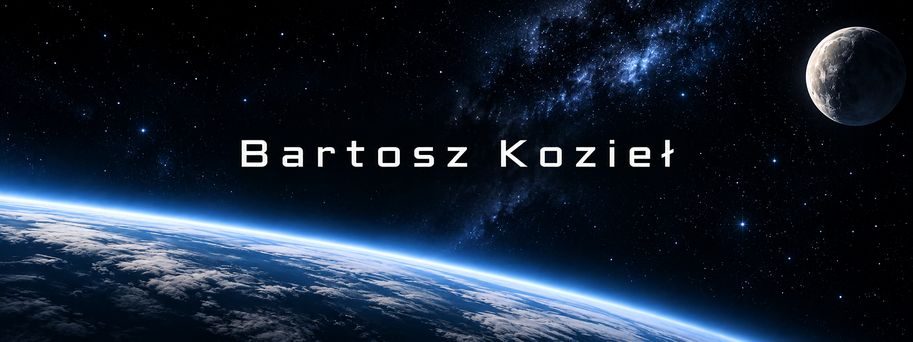

  

<h1 align="center">Hi, I'm Bartek 🚀</h1>

  <b>Space Technologies MSc student</b> at AGH University of Krakow 
  Member of the ThrustLab AGH student research group

  
  

---

### About me

I'm an engineering graduate currently pursuing a Master's degree in Space Technologies at AGH University of Krakow.

I'm interested in aerospace technology, mechanical design, experimental testing and materials science. I enjoy working on practical engineering projects, from initial concepts and hardware integration to testing and data analysis.

### What I'm working on

- **Master's thesis:** protecting reflective surfaces against abrasion by lunar regolith
- **Rocket Test Stand:** a rocket engine thrust measurement stand, built with ThrustLab AGH
- **Learning:** ESA's *Space for Everyone* course

### Projects

| Project | Description |
| --- | --- |
| **Rocket Test Stand** | ThrustLab AGH project. I was responsible for building the thrust measurement stand and for its configuration. |
| **Silver Trading Bot** | Personal project written with the help of AI. It analysed several factors, assessed whether silver was worth buying and sent me notifications on Discord. |
| **[Personal website](https://vernoncruel.github.io)** | A one-page site about me, my education and my projects. |

### Skills

  
  
  
  
  

### Beyond engineering

Basketball, chess, piano and anything related to space.
